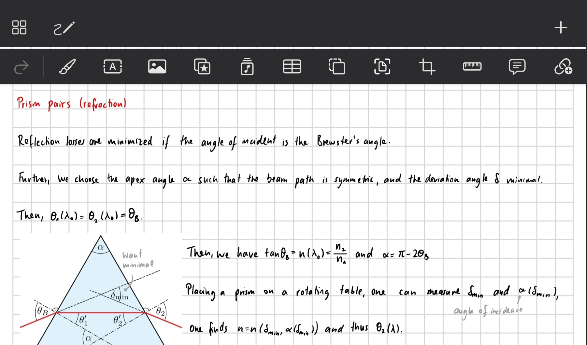
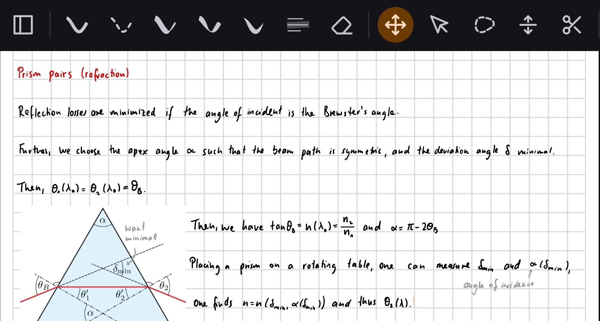

# notein-xnotes-converter

Convert handwritten notes from **[Notein](https://play.google.com/store/apps/details?id=com.orion.notein.global)** (`.in`) to **[xnotes](https://github.com/shardulvs/xnotes-android)** (`.xnote`) and back.

Every stylus stroke stays a separate, editable vector stroke (with pressure). Nothing is flattened into an image.

<table>
  <tr>
    <td width="50%"></td>
    <td width="50%"></td>
  </tr>
  <tr>
    <td align="center"><sub>Notein (original)</sub></td>
    <td align="center"><sub>xnotes (converted)</sub></td>
  </tr>
</table>

## Usage

Needs only Python 3.8+ (no extra packages).

```bash
python notein_xnotes.py "My note.in"                 # -> My note.xnote
python notein_xnotes.py "My note.xnote"              # -> My note.in
python notein_xnotes.py notein_exports/ -o converted/ # whole folder, all CPU cores, progress bar
python notein_xnotes.py "My note.in" --no-background # leave out the page background PDF
python notein_xnotes.py "My note.in" --ink pen       # plain xnotes pen instead of natural ink
```

Export a note from Notein as `.in`, convert it, and put the `.xnote` in your xnotes notes folder.

## What is converted

| | Notein → xnotes | xnotes → Notein |
|---|---|---|
| Pen / highlighter strokes | ✅ | ✅ |
| Images | ✅ | ✅ (not SVG) |
| Lines and other shapes | ✅ | lines ✅, other shapes as strokes |
| PDF / custom page background | ✅ (optional) | ✅ (optional) |
| Multiple pages | ✅ | ✅ |
| Text boxes, audio, links | ❌ skipped | ❌ skipped |

- `--ink natural` (default) keeps Notein's ink look in xnotes: strokes thin out at their ends like real ink, curves are smooth, and pressure behaves linearly. Under the hood this is xnotes' calligraphy tool with its slant effect switched off.
- xnotes → Notein is **experimental**: it builds Notein's database from `notein_schema.sql` and has been checked for structure only.

## Disclaimer

Unofficial and not affiliated with Notein or xnotes. Notein's format is undocumented and may change. Keep your originals.

## License

[MIT](LICENSE)
